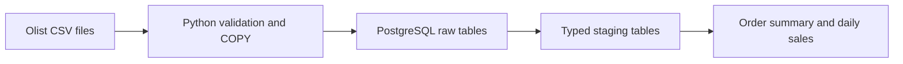

# InsightFlow AI

An e-commerce data and AI platform using the Olist dataset. The current setup loads nine source CSV files into PostgreSQL, builds typed staging tables, and provides order and daily sales analytics.

**Status:** the data pipelines and weekly cloud schedule work, and an experimental delivery-delay baseline is trained. Predictive improvements, the AI assistant, and the dashboard remain in the [roadmap](docs/ROADMAP.md).

The [scheduled cloud pipeline](docs/SCHEDULING.md) runs Mondays at 08:00 Taiwan time, with manual runs available in GitHub Actions.

The [checkout-time delivery prediction dataset](docs/DELIVERY_PREDICTION.md) has chronological splits that respect label availability. The first [logistic baseline](docs/BASELINE_MODEL.md) is trained and versioned; its weak held-out performance is documented and it is not deployed. A [validation error analysis](docs/BASELINE_ERROR_ANALYSIS.md) records calibration gaps and segment errors. A [historical model comparison](docs/MODEL_COMPARISON.md) found no improvement from cyclic month encoding or the fixed gradient-boosted candidate; the original model remains unchanged.

Google Cloud setup begins with the [cloud foundation guide](infrastructure/README.md).



## Get the code

Prerequisites: Git and Docker Desktop with the Linux engine running. A local Python installation is optional because the commands below run Python in Docker.

```powershell
git clone https://github.com/quyenmcu/insightflow-ai-data-platform.git
cd insightflow-ai-data-platform
```

The repository is public; cloning does not require repository access approval.

## Local database

Start Docker Desktop, then run these commands from the project directory in PowerShell:

```powershell
# Only on a new checkout; keep an existing .env file.
Copy-Item .env.example .env
# Edit .env and replace the example password before starting the database.
docker compose config --quiet
docker compose up -d --wait postgres
docker compose ps
```

Use your own local password in `.env`. `.env`, `.venv`, and downloaded data are ignored by Git and are not included in the repository.

The database is available at `127.0.0.1:5433`. The database name and user default to `insightflow`; the password is stored in `.env`. Containers connect using `postgres:5432`.

Open a SQL session:

```powershell
docker compose exec postgres psql -U insightflow -d insightflow
```

Stop the services with `docker compose down`. The named volume preserves database data. Changing `.env` credentials after database initialization does not change existing database roles.

## Download the source data

Source: [Brazilian E-Commerce Public Dataset by Olist](https://www.kaggle.com/datasets/olistbr/brazilian-ecommerce). Follow the dataset's license and attribution requirements when sharing derived work. Source data is excluded from Git and the Docker image.

On a new checkout, download the source files:

```powershell
New-Item -ItemType Directory -Force data/raw/olist | Out-Null
curl.exe --fail --location --retry 2 --output data/raw/olist.zip https://www.kaggle.com/api/v1/datasets/download/olistbr/brazilian-ecommerce
if ($LASTEXITCODE -ne 0) { throw 'Olist download failed' }
Expand-Archive -LiteralPath data/raw/olist.zip -DestinationPath data/raw/olist
```

If Kaggle requests authentication, download the archive from the dataset page and extract its nine CSV files into `data/raw/olist`.

## Load and verify

```powershell
docker compose build ingestion
docker compose run --rm ingestion
Get-Content sql/verify_raw.sql -Raw | docker compose exec -T postgres psql -v ON_ERROR_STOP=1 -U insightflow -d insightflow
```

The loader checks exact headers, CSV record widths, nonempty files, row counts, and the natural keys of customers, orders, items, payments, products, sellers, and category translations. Geolocation and reviews retain source duplicates. All raw columns use PostgreSQL `TEXT` to preserve IDs, ZIP prefixes, and original values. CSV empty fields follow PostgreSQL COPY semantics: unquoted empty fields become NULL, while quoted empty strings remain empty strings.

Each successful load refreshes all nine `raw` tables in one transaction, so rerunning the same data does not append duplicates. A failure rolls back the whole refresh. `raw.ingestion_runs` records the source URL, per-file SHA-256 digests, row counts, and load time. Its audit history grows with each successful run. This refresh owns the nine raw tables; do not manually edit their data.

## Build typed tables and analytics

After each successful raw refresh, run:

```powershell
docker compose build ingestion
docker compose run --rm ingestion python -m ingestion.batch.build_analytics
Get-Content sql/verify_analytics.sql -Raw | docker compose exec -T postgres psql -v ON_ERROR_STOP=1 -U insightflow -d insightflow
```

The command refreshes nine `staging` tables in one transaction. IDs and ZIP prefixes remain text. Timestamps retain the source's timezone-free representation. Monetary amounts and coordinates use exact PostgreSQL `NUMERIC`; counts, measurements, and review scores use integers. Empty or whitespace-only fields become NULL. City names and categories become lowercase; state codes become uppercase. Free-form review text retains its original whitespace. The two source product columns ending in `lenght` are renamed to `length`.

Primary keys, required fields, foreign keys, nonnegative monetary values and product measurements, coordinate bounds, and review scores from 1 to 5 are enforced. Legitimate missing product attributes and delivery timestamps remain NULL. Source review and geolocation duplicates are preserved. No foreign key is imposed on product category translations or ZIP lookups because those source mappings may be incomplete. A failed build preserves the previous staging data, views, and audit history.

| Model | Grain and meaning |
| --- | --- |
| `analytics.order_summary` | One row per order, with item, payment, and review aggregates computed separately before joining. Orders with no items or payments have zero totals and counts. Missing reviews have a NULL mean score. |
| `analytics.daily_sales` | Delivered orders grouped by purchase date. Item GMV is the sum of item prices, excluding freight. Payment totals are reported separately. |
| `analytics.build_runs` | Successful build time, source raw run ID, and staging row counts. |

`is_late_delivery` compares actual and estimated **calendar dates**, so delivery later on the estimated day counts as on time. It is NULL for orders that are not delivered or lack either timestamp. Delivery timestamps and reviews are outcome data and must be excluded from purchase-time model features.

The verification query reports differences between summary and staging totals; each difference should be zero. It also checks whether the latest build uses the latest raw run. The views read the most recent successful staging refresh; loading new raw data alone does not refresh staging. The two refresh commands use a shared transaction lock so they cannot interleave.

## Tests

Run the integration checks, which create and drop temporary test databases:

```powershell
docker compose run --rm -v "${PWD}/tests:/app/tests:ro" -v "${PWD}/infrastructure:/app/infrastructure:ro" ingestion python -m pytest -q /app/tests
```

The checks cover repeat loads and builds, multiline Unicode CSV fields, UTF-8 byte-order marks, leading zeros, malformed input, aggregation without multiplied totals, date labels, and rollback after invalid values or foreign keys. Docker runs Python independently of the local `.venv`.

GitHub Actions runs this suite on pushes, pull requests, and manual workflow runs. CI uses synthetic CSV fixtures, a disposable PostgreSQL database, and mocked cloud responses; it does not download Olist or require cloud credentials. See the [workflow](.github/workflows/tests.yml).

## Project files

| Path | Purpose |
| --- | --- |
| `ingestion/batch/load_olist.py` | Validate and refresh the raw data. |
| `ingestion/batch/build_analytics.py` | Refresh typed staging tables and analytics views. |
| `ingestion/batch/analytics_views.sql` | Define order summaries and daily sales metrics. |
| `sql/verify_*.sql` | Inspect row counts, totals, and source freshness. |
| `tests/` | Integration tests using isolated databases. |
| `docs/ROADMAP.md` | Completed work and planned milestones. |
