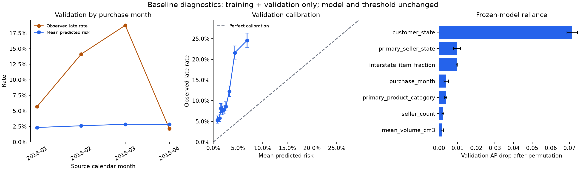

# Frozen baseline error analysis

The baseline underestimates delay risk on the eligible validation cohort. It remains experimental and is not ready for deployment. These diagnostics identify hypotheses for further experiments, not a demonstrated fix or a causal explanation.

## Scope and reproduction

Run `20261103T035040Z_e641d8c0` analyzes baseline `20261103T033356Z_3c721f9c` using only the original training and validation CSVs. The script verifies their hashes and the dataset manifest against the baseline metrics, loads the saved model, and checks its hash again after analysis. It neither fits a model nor changes the threshold (`0.03700299504351776`). No test CSV or saved test predictions are read. The previously reported test results remain unchanged.

From the repository root, with the original dataset generation available locally:

```powershell
docker compose --profile tools build analysis
docker compose --profile tools run --rm analysis
```

Outputs go into an immutable generation under `data/processed/baseline_analysis`; `LATEST.json` points to the completed generation. The [published aggregates](../reports/validation_baseline/report.json) include code/model hashes and library versions. Per-order error records stay in ignored local data. This command runs locally and does not query Google Cloud.

## Findings

Across 24,861 validation orders, observed late deliveries are **10.97%**, versus mean predicted risk **2.64%**: an 8.33 percentage point underestimate. Training prevalence was 5.05%. Average precision is 0.1998, compared with the validation prevalence of 0.1097 for random ranking. At the frozen threshold, precision is 22.94% and recall is 42.79%; there are 3,921 false positives and 1,560 false negatives.

| Purchase month | Eligible orders | Observed late | Mean predicted risk |
| --- | ---: | ---: | ---: |
| January 2018 | 7,069 | 5.70% | 2.34% |
| February 2018 | 6,555 | 14.13% | 2.61% |
| March 2018 | 6,971 | 18.75% | 2.86% |
| April 2018 | 4,266 | 2.13% | 2.83% |

These are **label-mature, delivered-order cohorts**, not all orders in each month. Validation requires labels available before May 1. Orders near that boundary with longer unresolved delivery promises are excluded, while early on-time arrivals can already qualify. April's low rate must not be interpreted as a clean improvement in delivery operations. The cutoff can also change feature and outcome composition; the chart alone cannot distinguish this selection effect from real temporal change.



Customer location dominates this model's validation ranking: shuffling `customer_state` reduces average precision by 0.0715 on average, followed by seller state (0.0097) and interstate item fraction (0.0095). These are three-repeat permutation estimates for this fitted model, not causal effects or intrinsic feature values. Correlated geography features share information; error bars show permutation standard deviation, not a confidence interval for model quality.

Large customer-state cohorts show different error patterns. SP has 10,895 orders and 583 missed late deliveries; MG has 2,969 orders and 274 missed late deliveries. RJ has 2,996 orders, a 23.56% late rate, and 1,540 false alerts. These descriptive counts combine volume, threshold behavior, and cohort composition; they do not establish location-specific remedies. Published segment rows require at least 200 orders and 20 positive labels; suppressed groups still contribute to overall results, so displayed groups need not sum to the total.

The strongest numeric mean shift is `purchase_month` (-1.79 training standard deviations), which is expected across these calendar windows. The model treats month as a linear number, suggesting a hypothesis to test about calendar representation. Other numeric mean shifts are much smaller (absolute standardized shifts below 0.083). Product-category total variation distance is 0.133; unseen seller states affect 0.28% of validation rows. These summaries do not rule out changes in relationships or interactions.

## Limits and next experiments

Calibration uses ten approximately equal-frequency score bins with approximate 95% Wilson intervals for observed event rates. Those intervals assume independent observations and do not adjust for repeated sellers, temporal dependence, or multiple comparisons. Brier score combines discrimination and calibration; it is not a pure calibration measure. Static catalogue availability and the delivered-only target remain assumptions described in the [dataset guide](DELIVERY_PREDICTION.md).

1. Evaluate expanding historical time folds within the development period, preserving label availability at each origin. Report retained/excluded cohorts and use a consistent maturation horizon to examine cutoff selection before comparing models.
2. Compare the fixed baseline against categorical or cyclic month encoding and a small nonlinear candidate using those development folds. Treat these as hypotheses, keep preprocessing inside each training fold, and report aggregate performance and variability.
3. If calibration is attempted, fit it on a distinct earlier calibration window and assess it on a later development window. Do not fit and assess calibration on the same rows.
4. Define an operational alert budget or error cost before choosing a deployment threshold; maximizing historical F1 does not establish business value.
5. Require genuinely new, prospectively reserved outcomes before final acceptance. The historical Olist test has already been inspected and cannot become an untouched holdout again.

No candidate comparison, recalibration, threshold reselection, or cloud deployment is part of this analysis.

Method references: [scikit-learn calibration documentation](https://scikit-learn.org/stable/modules/calibration.html) and [permutation importance documentation](https://scikit-learn.org/stable/modules/permutation_importance.html).
